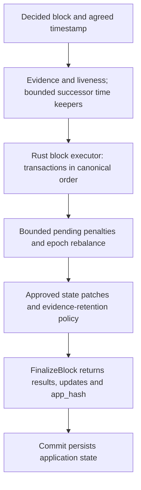

# Block Execution

Every validator executes a block's transactions one after another in the
canonical block order. The result of a block is fully determined by that
order, so every validator reaches the same state, receipts, chi, events and
`app_hash`.

## Execution Model

The Rust block executor reads call inputs from the validated wire bytes and
uses the decided block metadata for execution context. It reads and stages
state through a block overlay, reserves and settles fees, and computes
rewards. The native VM encodes the receipt with the result or error, writes,
events, chi, and any fee payouts. Contract failures produce receipts and
roll back application writes and events. A host fault such as unreadable
state or a storage error halts the node.

Before the paid loop, the node applies agreed evidence/liveness and advances
bounded time-checkpoint and staking-anchor work. After it, the node advances
pending penalties and epoch selection, applies approved patches, and stages
the evidence policy and state root. These system effects also contribute to
`app_hash`; they are not ordinary user transactions in BDS history.

## Related Pages

- [Transaction Lifecycle](/concepts/transaction-lifecycle)
- [Deterministic Execution](/concepts/deterministic-execution)
- [The Xian VM](/concepts/xian-vm)
