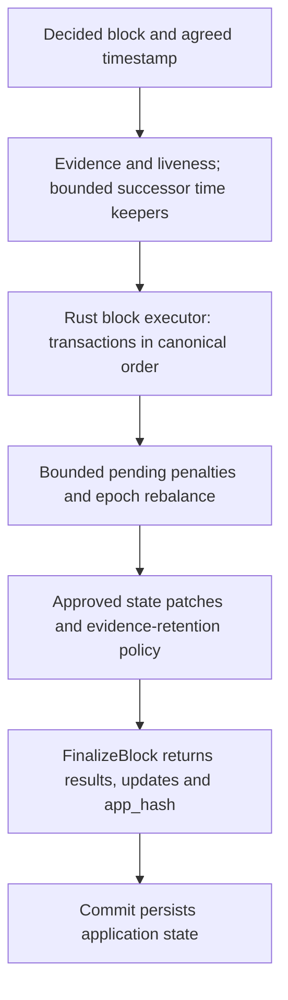

# Block Execution

Every validator executes a block's transactions one after another in the
canonical block order. The result of a block is fully determined by that
order, so every validator reaches the same state, receipts, chi, events and
`app_hash`.

## Execution Model

Validators run the per-transaction loop in Rust, inside the native VM package,
without holding the Python interpreter lock. The executor reads each
transaction's call, arguments and context from its wire bytes and gives every
transaction a receipt. Storage reads, the block overlay, fee reservation and
settlement, and reward deltas are handled in Rust. There is no Python
execution path: a transaction the VM cannot run fails with an ordinary
receipt, and only a host fault (unreadable state, out of memory, operating
system or storage errors) halts the node.

Before the paid loop, the node applies agreed evidence/liveness and advances
bounded time-checkpoint and staking-anchor work. After it, the node advances
pending penalties and epoch selection, applies approved patches, and stages
the evidence policy and state root. These system effects also contribute to
`app_hash`; they are not ordinary user transactions in BDS history.

## No Parallel Execution

A node refuses to start when its `config/xian.toml` still sets one of the
removed keys (`parallel_execution_enabled`, `parallel_execution_workers`,
`parallel_execution_min_transactions`, `parallel_execution_max_speculative_waves`,
`parallel_execution_min_wave_acceptance_ratio`,
`parallel_execution_low_acceptance_min_wave_size`,
`parallel_execution_warm_workers`, `parallel_execution_access_estimates_enabled`).
The error names the keys to delete. Re-rendering the home with
`xian-configure-node` or `xian node init` writes a configuration without them.
Node profiles and network templates that still carry `parallel_execution_*`
fields or `advanced.parallel_execution` are rejected as unknown fields.

## Related Pages

- [Transaction Lifecycle](/concepts/transaction-lifecycle)
- [Deterministic Execution](/concepts/deterministic-execution)
- [The Xian VM](/concepts/xian-vm)
