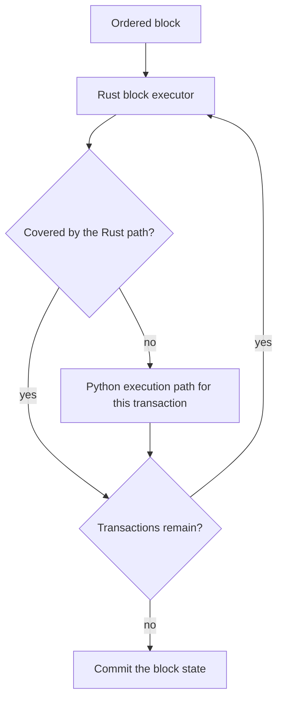

# Block Execution

Every validator executes a block's transactions one after another in the
canonical block order. The result of a block is fully determined by that
order, so every validator reaches the same state, receipts, chi, events and
`app_hash`.

## Execution Model

Validators run the per-transaction loop in Rust, inside the native VM package,
without holding the Python interpreter lock. Storage reads, the block overlay,
fee reservation and settlement, and reward deltas are handled in Rust. A
transaction that uses a host feature the Rust path does not cover yet runs on
the Python execution path at its own position in the block, and the Rust loop
continues after it. Both paths produce byte-identical outcomes; differential
tests compare them on every change.

## No Parallel Execution

Transactions are not executed in parallel. Xian previously shipped an optional
speculative executor that ran transactions in worker processes. Serial
execution in Rust became faster than that executor, so it was removed together
with its settings.

A node refuses to start when its `config/xian.toml` still sets one of the
removed keys (`parallel_execution_enabled`, `parallel_execution_workers`,
`parallel_execution_min_transactions`, `parallel_execution_max_speculative_waves`,
`parallel_execution_min_wave_acceptance_ratio`,
`parallel_execution_low_acceptance_min_wave_size`,
`parallel_execution_warm_workers`, `parallel_execution_access_estimates_enabled`).
The error names the keys to delete. Re-rendering the home with
`xian-configure-node` or `xian node init` writes a configuration without them.
Node profiles and network templates that still carry `parallel_execution_*`
fields or `advanced.parallel_execution` are rejected as unknown fields.

A future parallel design (Block-STM-style execution in Rust) is a deferred
plan, not a feature. Any such design must keep results identical to serial
block order.

## Related Pages

- [Transaction Lifecycle](/concepts/transaction-lifecycle)
- [Deterministic Execution](/concepts/deterministic-execution)
- [The Xian VM](/concepts/xian-vm)
