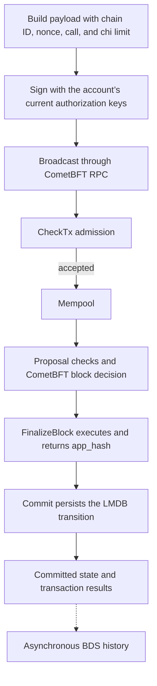

# Transaction Lifecycle

A Xian transaction moves through signing, mempool admission, consensus,
deterministic execution, atomic commit, and optional indexing.

## Payload and Signature

The signed payload includes:

- sender, chain ID, and nonce
- target contract and exported function
- keyword arguments
- submitted chi limit

The chain ID prevents cross-network replay. The nonce orders transactions from
one sender and prevents reuse on the same chain.

SDKs support `async`, `checktx`, and `commit` broadcast modes. `checktx`
returns mempool admission; it does not prove final execution success. Use a
receipt wait when the application needs finality.

## Hybrid Account Enrollment

The node supports a consensus-controlled account registry for Ed25519 plus
ML-DSA-65 authorization. Enrollment is disabled in the default network bundles.
The registry policy controls whether an unenrolled address can enroll.

Enrollment preserves the existing sender string exactly. Native/token balances,
allowances, contract ownership, `ctx.signer`, and the nonce sequence keep the
same identity. An unenrolled account continues using its existing Ed25519 key.
Enrollment requires the existing key's authorization and possession proofs for
both a new active pair and a separate recovery pair. Both signatures are required
for each hybrid pair.

After successful enrollment commits, the old key alone cannot spend or recover
that account. The SDKs and wallets derive active and recovery credentials from
one fresh master and require a verified master backup per account and chain.
These credentials cannot be reconstructed from the original mnemonic or private
key. Recovery uses the
separate pair to install fresh active and recovery keys, and retains the account's
balances and permissions. Recovery is immediate; it does not veto an attacker
who already controls both active secrets.

Registry transactions use explicit `xian_account_v1` metadata and the native
`_accounts` operations `enroll`, `rotate`, and `recover`. They do not call a
user-deployed contract. The chain policy sets a fixed chi cost for these
operations; paid networks charge the corresponding fee. Failed transitions do
not change authorization. The transaction nonce can still be consumed when an
otherwise valid transaction fails during execution, as with ordinary calls.

After a registry operation is included, later transactions from the same sender
must wait until the next committed block. CheckTx acceptance alone does not
activate keys. Registry records and policy are included in the app hash,
atomic commit, snapshots, and state exports.

See [hybrid backups and recovery](hybrid-account-recovery.md) for the SDK and
wallet migration workflow.

## CheckTx

Before mempool admission, the application checks payload shape, signature,
chain ID, nonce, and fee policy. Paid mode requires enough native-token balance
to cover the submitted chi limit. Free-metered mode enforces configured
transaction and block chi caps.

A CheckTx rejection does not enter the mempool or change chain state.

## Consensus and Execution

CometBFT fixes transaction order and the block timestamp. During
`FinalizeBlock`, every validator executes the same ordered contract calls through
`xian_vm_v1`; native account-registry operations use the node registry handler.

For each transaction, the runtime:

1. injects `ctx` and block metadata
2. dispatches the exported function
3. meters VM operations, storage, and host calls
4. buffers writes, events, return value, and fee/reward effects
5. discards application writes and events on failure

Optional parallel execution may speculate in worker processes, but accepted
results must remain equivalent to serial block order. Conflicts run serially.

## Commit

Successful transaction effects and required fee accounting are assembled into
one block transition. Xian commits state, nonce data, height, block time, and
the state-root marker atomically in LMDB. `FinalizeBlock` returns the computed
`app_hash` before this persistence step; `Commit` makes the corresponding
transition durable. CometBFT includes the hash in the next block header.

The LMDB marker is authoritative on restart; auxiliary JSON metadata is only a
repairable convenience copy.

## Results

The decoded execution payload includes:

| Field | Meaning |
| --- | --- |
| `hash` | Xian execution-result hash; distinct from the CometBFT RPC transaction hash |
| `status` | `0` success, `1` failure |
| `chi_used` | metered chi charged/reported |
| `result` | encoded function result or error |
| `state` | committed writes, including fee effects where applicable |
| `events` | committed contract events |

SDK receipts wrap this together with the original transaction, RPC metadata,
and success/error helpers.

Use the CometBFT transaction hash returned by broadcast for RPC receipt lookup
and BDS queries. The embedded execution-result hash uses a separate Xian hash
calculation and is not interchangeable with that lookup identifier.

When the transaction index is unavailable, the Python SDK can recover a receipt
from recent blocks. A visible block alone does not establish execution success:
the SDK waits for that block's execution results and reports their actual status.
If those results lag behind the block, receipt polling retries the same block
until the results arrive or the configured timeout expires.

## Failure Boundaries

| Failure | State/effects |
| --- | --- |
| CheckTx rejection | no mempool entry, no state, no fee |
| assertion or runtime error | application writes/events roll back; paid mode charges consumed chi |
| out of chi | application writes/events roll back; failed execution reports a bounded cost up to the submitted limit |

## Indexing

CometBFT RPC and transaction search expose finalized data. Dashboard WebSockets
provide live non-durable notifications. BDS indexes blocks asynchronously, so
history/event rows can appear shortly after finality.

## Related Pages

- [Parallel Block Execution](/concepts/parallel-block-execution)
- [Chi and Metering](/concepts/chi)
- [BDS Indexed Queries](/api/bds)
