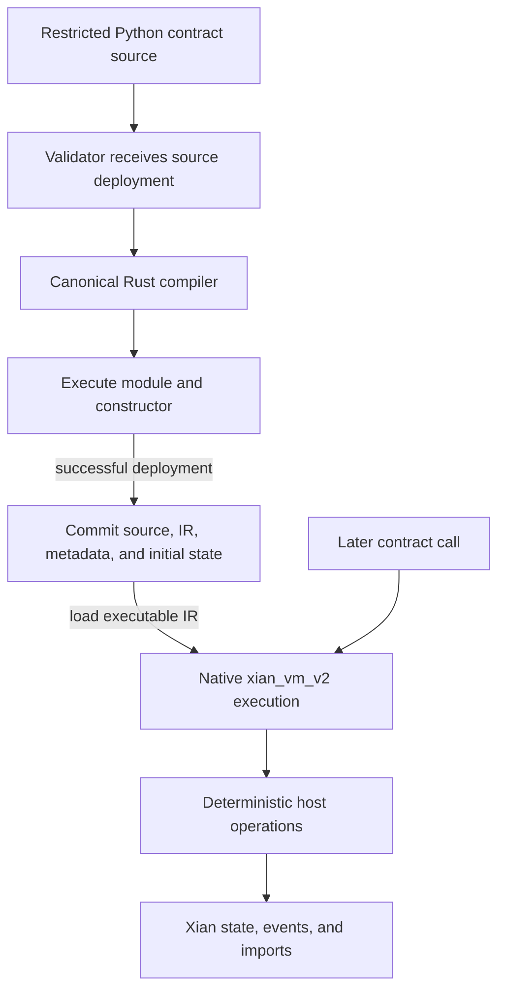

# The Xian VM

The Xian VM is the execution layer that lets Xian keep Python as the contract
authoring language without making CPython bytecode the consensus format.

## Execution profiles

Validators compile cleartext contract source into canonical IR and execute it in Rust. The fresh-chain node requires `xian_vm_v2`. Historical nodes and the default off-chain compiler profile use `xian_vm_v1`. The two share the IR envelope name `xian_ir_v1`; the IR's `vm_profile` identifies its execution rules. Replaying a V1 network requires its pinned image and policy.

V2 uses bounded integers and exact fixed-point decimals. Source literals preserve their digits, division produces a decimal and the rounding helpers take explicit inputs. See [Numbers, division and rounding](/smart-contracts/numbers).

## Testing contract behavior

Use the native local client for V2 tests and a node for integration with real transaction admission, state and fees. Compare returns, storage writes, events and rollback on failures. See [Testing](/smart-contracts/testing/).

Persisted dictionaries use string keys. In-memory collections and their keys have separate rules. See [Value methods](/smart-contracts/value-methods).

Within one execution, aliases, function arguments and imported-contract calls
share mutable objects. Collection copies are shallow; nested objects keep their
identity. `is` compares object identity. Do not rely on CPython's optional integer
or string interning. Native methods evaluate their receiver before arguments.

`map`, `filter`, `zip` and `reversed` produce consumable iterators. Callbacks
run when a value is requested; `all` and `any` stop as soon as their answer is
known. List iteration observes appends, dictionary views reflect the underlying
dictionary, and changing dictionary size during iteration fails. Materialize an
iterator or view with `list` or `tuple` before returning or storing it. Native
ranges are lazy; materialized collections remain subject to allocation limits.
The historical V1 Python harness limits range construction separately.

Function defaults are evaluated in module definition order and retain their
identity across calls within an execution. A fresh execution initializes them
again. Keyword argument dictionaries preserve call-site order.

`sorted` and `list.sort` support stable `key`/`reverse` ordering; keys run once
per item. `min`/`max` support `key` and an empty-iterable `default`, and `sum`
supports `start` while rejecting text and bytes. Integer text conversion accepts
base zero, matching prefixes and valid digit separators. V2 enforces its numeric profile on arithmetic operations.

Ordinary module variables may be reassigned in source order; function defaults
capture the value present at their definition. Storage declarations, imports and
function names remain unique. Calls and list/tuple literals support starred
iterable expansion, and nested assignments, loops and comprehensions support one
starred target per target sequence. Expansion is metered and limited to 128 Ki
items. Duplicate keyword arguments fail during argument merging.

`dict.update` consumes iterable pairs incrementally, `setdefault` preserves the
supplied object's identity, and `list.reverse` mutates the existing list.
`bytes.fromhex` accepts a string with ASCII whitespace between complete byte
pairs and limits decoded output to 128 KiB. Integer string parsing supports Unicode 15.0 digits. The V2 decimal parser accepts ASCII digits. Same-size dictionary key replacement follows historical insertion
slots and cursor behavior; replacing a visited key can still raise a mutation
error. Prefer completing an iteration before changing its keys.

Storage writes snapshot values, and reads return detached copies. Mutating a
read value changes storage only after an explicit write. Cycles may exist in
memory but cannot cross storage or public result boundaries. The native heap
limits live object accounting to 128 MiB and 1,048,576 objects; mutable objects
remain retained until execution ends. Boundary traversal and rendering are
bounded, and a limit failure rolls back transaction effects.

Runtime fixes can change contract results. Validators participating in one
network must use a consistent compiler and VM version when replaying blocks.

## Source and executable IR

Under `xian_vm_v2`, deployment is source-driven.

The important stored artifacts are:

- `__source__`: canonical human-facing source used by explorers, dashboards,
  and inspection tooling
- `__xian_ir_v1__`: the persisted Xian VM IR used by the native runtime

Clients submit cleartext source. Validators normalize, lint, and compile that
source with the canonical Rust compiler, then persist the resulting source and
IR.
Submitted `deployment_artifacts` are rejected so clients cannot choose the
executable IR.

## Execution Policy

VM-native execution is the fixed node execution runtime.

On the supported branch:

- fresh genesis selects the V2 numeric profile and the node checks it on startup
- bytecode, gas schedule, and authority are internal VM constants
- submitted contracts must provide source code

This keeps the execution contract explicit without exposing alternate engines
or an operator-selectable execution policy section.

## What The Native Runtime Does

The native runtime is not a second unrestricted Python interpreter. It executes
validator-derived Xian VM IR and delegates explicit host operations back to the
Xian runtime boundary.

That host boundary includes things such as:

- `Variable` and `Hash` reads and writes
- `ForeignVariable` and `ForeignHash` reads
- event emission
- contract import and export calls
- hashing and signature verification bridges
- `zk.*` verification syscalls

Those operations are deterministic runtime calls, not arbitrary operating-system
syscalls.

## What Stays The Same For Contract Authors

Contract authors work with the familiar Xian model:

- `@construct` and `@export`
- `Variable`, `Hash`, and foreign state helpers
- `ctx`, `now`, events, and imports
- chi budgeting and deterministic rollback semantics

## Why The Xian VM Matters

The Xian VM gives the platform an explicit machine contract:

- execution semantics become Xian-defined instead of CPython-bytecode-defined
- metering can be attached directly to VM operations and host calls
- submitted source can be validated and compiled into canonical IR
- replay and parity testing become easier to reason about

## Scope

The VM-native runtime covers real authored contract behavior,
including storage flows, decimals, datetime helpers, hashing, Ed25519
verification, imports, events, and the shielded contract helpers needed by the
existing shielded stack.

It is the supported execution path for node deployments.

## Related Pages

- [Deterministic Execution](/concepts/deterministic-execution)
- [Chi & Metering](/concepts/chi)
- [Runtime Features](/node/runtime-features)
- [Contract Submission Internals](/reference/submission-internals)
