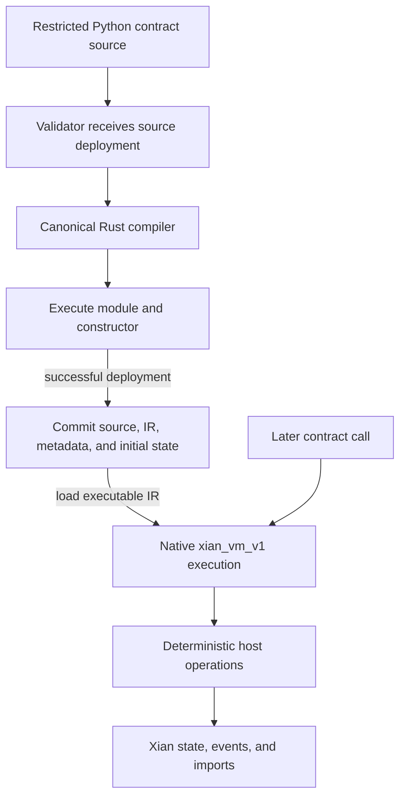

# The Xian VM

The Xian VM is the execution layer that lets Xian keep Python as the contract
authoring language without making CPython bytecode the consensus format.

## The Two Layers To Keep Separate

There are always two distinct questions in Xian:

1. What language does the developer write?
2. What machine executes that program on validators?

Developers write a restricted Python subset. Nodes execute it through the fixed
`xian_vm_v1` model.

## Execution Mode

| Mode | What executes |
|------|----------------|
| `xian_vm_v1` | validator-derived canonical IR under a native runtime |

The source language remains a restricted Python subset. The supported node
runtime is fixed to the VM artifact path; acceptance by the compiler does not
guarantee identical behavior to every Python operation.

## Testing Python Compatibility

The local Python harness is useful for contract tests, but complete semantic
parity with the native VM has not been established. Test deployment and calls
through `xian_vm_v1`, particularly when using iterator consumption or
optional builtin arguments. Compare results, storage writes, events and failed
transactions, rather than checking only that source compiles.

The runtime's compatibility suite includes a pinned pre-VM Python baseline.
It checks source admission independently and preserves value types and dictionary
key order when comparing returns, writes, events, and failure outcomes. Its
coverage is bounded; it does not establish full language or metering parity.

Dictionary operations reject unhashable keys, including lists, dictionaries,
bytearrays, mutable sets, decimal/time objects, and tuples containing unhashable
members. Equal numeric keys such as `True`, `1`, and `float("1")` address one
entry; replacement preserves the first key and its position. Large integers
remain distinct from nearby rounded floats. These in-memory rules do not relax
the string-key requirement for dictionaries persisted in contract storage.
Deterministic sets have their own member eligibility rules, including support
for decimal/time values.

Within one execution, aliases, function arguments and imported-contract calls
share mutable objects. Collection copies are shallow; nested objects keep their
identity. `is` compares object identity. Do not rely on CPython's optional integer
or string interning. Native methods evaluate their receiver before arguments.

Storage writes snapshot values, and reads return detached copies. Mutating a
read value changes storage only after an explicit write. Cycles may exist in
memory but cannot cross storage or public result boundaries. The native heap
limits live object accounting to 128 MiB and 1,048,576 objects; mutable objects
remain retained until execution ends. Boundary traversal and rendering are
bounded, and a limit failure rolls back transaction effects.

Runtime fixes can change contract results. Validators participating in one
network must use a consistent compiler and VM version when replaying blocks.

## What `xian_vm_v1` Actually Uses

Under `xian_vm_v1`, deployment is source-driven.

The important stored artifacts are:

- `__source__`: canonical human-facing source used by explorers, dashboards,
  and inspection tooling
- `__xian_ir_v1__`: the persisted Xian VM IR used by the native runtime

Clients submit cleartext source. Validators normalize, lint, and compile that
source with the canonical Rust compiler, then persist the resulting source and
IR.
Submitted `deployment_artifacts` are rejected so clients cannot choose the
executable IR.

## Execution Policy

VM-native execution is the fixed node execution runtime.

On the supported branch:

- `xian_vm_v1` is the only supported node runtime
- bytecode, gas schedule, and authority are internal VM constants
- submitted contracts must provide source code

This keeps the execution contract explicit without exposing alternate engines
or an operator-selectable execution policy section.

## What The Native Runtime Does

The native runtime is not a second unrestricted Python interpreter. It executes
validator-derived Xian VM IR and delegates explicit host operations back to the
Xian runtime boundary.

That host boundary includes things such as:

- `Variable` and `Hash` reads and writes
- `ForeignVariable` and `ForeignHash` reads
- event emission
- contract import and export calls
- hashing and signature verification bridges
- `zk.*` verification syscalls

Those operations are deterministic runtime calls, not arbitrary operating-system
syscalls.

## What Stays The Same For Contract Authors

Contract authors work with the familiar Xian model:

- `@construct` and `@export`
- `Variable`, `Hash`, and foreign state helpers
- `ctx`, `now`, events, and imports
- chi budgeting and deterministic rollback semantics

In other words, `xian_vm_v1` changes the execution machine, not the basic
developer-facing contract model.

## Why The Xian VM Matters

The Xian VM gives the platform an explicit machine contract:

- execution semantics become Xian-defined instead of CPython-bytecode-defined
- metering can be attached directly to VM operations and host calls
- submitted source can be validated and compiled into canonical IR
- replay and parity testing become easier to reason about

## Scope

The VM-native runtime covers real authored contract behavior,
including storage flows, decimals, datetime helpers, hashing, Ed25519
verification, imports, events, and the shielded contract helpers needed by the
existing shielded stack.

It is the supported execution path for node deployments.

## Related Pages

- [Deterministic Execution](/concepts/deterministic-execution)
- [Chi & Metering](/concepts/chi)
- [Runtime Features](/node/runtime-features)
- [Contract Submission Internals](/reference/submission-internals)
