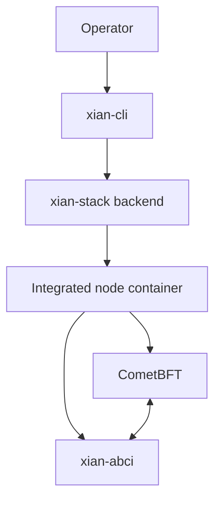

# Architecture

Xian node operations are intentionally split across multiple repos so the
deterministic core, operator UX, and runtime backend stay cleanly separated.

## Repo Responsibilities

| Repo | Responsibility |
|------|----------------|
| `xian-cli` | operator-facing commands and local manifest/profile artifacts |
| `xian-stack` | Docker images, Compose topology, backend control surface |
| `xian-abci` | deterministic node process, query handling, config rendering |
| `xian-configs` | canonical network bundles and contract bundles |
| `xian-contracting` | canonical Rust compiler, native VM packages, deterministic storage/host helpers, local test harness |
| `xian-deploy` | remote Linux deployment of prepared homes and released images |
| `xian-py` | external SDK for apps, wallets, and transaction helpers |

## Runtime Shape

The node runs as a single container:

One container is simple to run and upgrade, uses an immutable image, and
supervises both processes natively. The dashboard runs from the same image as
a separate container.

## Optional Services

- Dashboard and explorer: separate HTTP/WebSocket service backed by CometBFT
  RPC
- Monitoring: optional Prometheus/Grafana stack plus the Xian app metrics
  endpoint
- BDS: optional indexed storage layer with asynchronous block ingestion,
  automatic catch-up from CometBFT RPC, and replay/reindex tooling
- GraphQL: optional PostGraphile v5 layer over the BDS Postgres database for
  convenience queries only
- Host-backed storage growth comes from chain data, Xian state, the BDS spool,
  and Postgres volumes rather than mutable growth inside a container image

These are not part of the deterministic execution path. The validator remains
authoritative for current-state reads through raw ABCI query, while BDS-backed
reads are indexed and eventually consistent.

## Deterministic Boundary

Consensus-sensitive behavior lives in `xian-abci` and `xian-contracting`:

- transaction validation and execution
- ABCI request handling
- state storage and app-hash generation
- instruction metering and linter rules

Runtime services such as Compose, dashboard, BDS, GraphQL, and supervisor
choice do not change consensus semantics.
