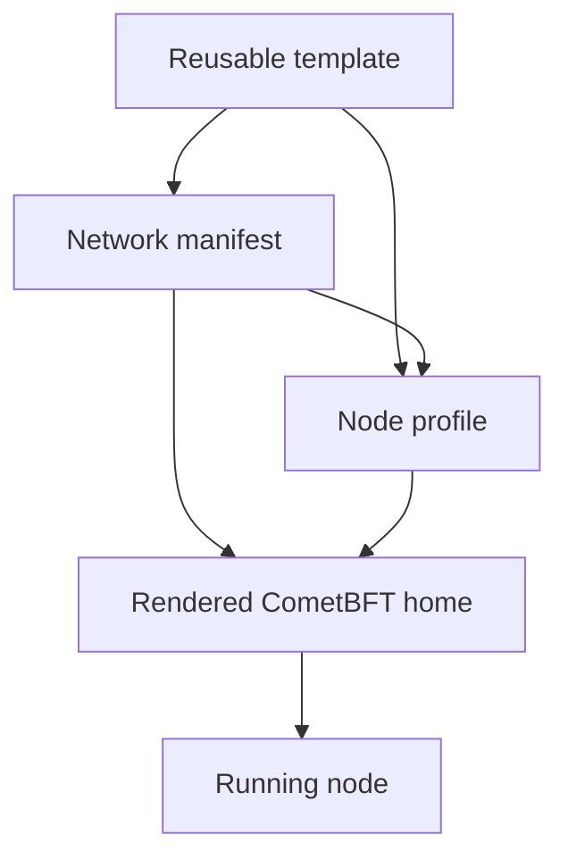

# Configuration

Xian node configuration has three layers:

1. a network manifest defines network-wide identity and defaults
2. a node profile records operator-local intent
3. `xian node init` renders the CometBFT home used at runtime



Use [Config Taxonomy](/node/config-taxonomy) for precedence and ownership
rules.

## Network Manifests

Canonical assets live in `xian-configs/networks/<name>/manifest.json`.
Manifests may define:

- chain identity and genesis source or bundle
- seeds and persistent peers
- snapshot bootstrap and trust material
- block-production policy
- pinned node images and release provenance
- runtime features and privacy artifact policy

The checked-in `local`, `devnet`, and `testnet` manifests are development or
rehearsal assets. The `xian-mainnet-1` manifest is a draft launch asset. None
of them implies that a public endpoint is live.

Templates under `xian-configs/templates/` are reusable starting points, not
networks.

Node initialization combines manifest seeds and persistent peers with the
profile's peer lists, in that order. A profile can add local peers without
discarding the network's persistent peers.

## Node Profiles

Profiles are JSON files normally created under `nodes/` by `xian-cli`. They
select local paths, keys, images, peers, pruning, block policy, logging,
simulation, metrics publishing, and optional services. The
fee policy is not a profile setting; it lives in the network manifest and
genesis.

See [Node Profiles](/node/profiles) for the profile contract. Prefer changing a
manifest or profile and re-rendering over hand-editing generated files.

## Rendered Home

The effective runtime home contains:

```text
config/config.toml
config/xian.toml
config/genesis.json
config/state-patches/
config/priv_validator_key.json
config/node_key.json
data/priv_validator_state.json
```

`config.toml` controls CometBFT. `xian.toml` controls Xian application
settings. Genesis, validator state, and keys must not be changed casually on an
existing network.

Evidence time retention is derived from staking policy at genesis and grows
automatically when longer unbonding is approved. Its committed target and
effective duration are recorded in `__evidence_policy`; they are not local
profile settings. See [Slashing and Evidence](/node/staking#slashing-and-evidence).

`xian_vm_v2` is the only supported execution runtime. Execution mode, VM
bytecode, and gas schedule are not operator-selectable configuration.

## Runtime Settings

Top-level Xian settings cover:

- pruning and retained block history
- application metrics and logging
- readonly simulation limits
- pending nonce reservation

The `[bds]` section configures the optional Postgres indexer, pool, catch-up,
and spool behavior. It is the only source of BDS settings: the node does not
read `XIAN_BDS_*` environment variables and refuses to start, naming them, when
one is set. The database password is never a `xian.toml` value. `[bds]
password_file` names the file the node reads it from when it connects; by
default that is `/run/secrets/xian_bds_password`, the secret that `xian-stack`
and `xian-deploy` mount from one owner-only file into both the node and
Postgres (`POSTGRES_PASSWORD_FILE`). A `[bds] password` key, or a `dsn` that
carries a password, is rejected at startup. See
[Runtime Features](/node/runtime-features).

The transaction fee mode and the per-transaction and per-block chi caps are
not `xian.toml` settings: they are the genesis fee policy `__fee_policy`,
identical on every validator, and a `xian.toml` that sets them is rejected at
startup. See [Chain Chi Caps](/concepts/chi#chain-chi-caps). Logging and query
limits can vary by node. The settings of the removed parallel executor
(`parallel_execution_*`) are rejected at startup as well; see
[Block Execution](/concepts/block-execution#no-parallel-execution).

## Stack Credentials

`xian-stack` keeps the BDS password in its own private, Git-ignored file,
`.stack-bds-password` (mode `0600`; `XIAN_BDS_PASSWORD_FILE` selects a
different path). It is created with a random value on first use and is the
only copy: Compose mounts it as `/run/secrets/xian_bds_password` into Postgres,
the node and the GraphQL role setup. The PostGraphile password stays in the
private, Git-ignored `.stack-secrets.env` (`XIAN_STACK_SECRETS_ENV` selects a
different path); a credentials file that still holds `XIAN_BDS_PASSWORD`, or
`XIAN_BDS_PASSWORD` in the environment, is refused with a message naming the
new file.

The credentials file is literal data. Its current format stores values as
JSON-quoted strings; a shared reader decodes them for the supported stack
workflows. A nonempty `XIAN_POSTGRAPHILE_PASSWORD` environment value takes
precedence over the stored value.

Use the supported `xian` node commands, or run
`python3 ./scripts/backend.py ...` from the stack checkout. Do not source this
file or evaluate its contents in a shell: variable and command expressions in
credentials are literal characters.

## Reproducible Genesis Builds

The Python genesis helpers in `xian.genesis_builder` accept an optional
`genesis_time` argument. For a reproducible build, supply a timezone-aware ISO
timestamp such as `2026-01-01T00:00:00.000000Z` and pin the other inputs,
including contract sources, compiler/runtime versions, validator keys, and
constructor arguments.

Combined network builders normalize the timestamp to UTC and use the same
instant for the CometBFT genesis header, submission and deployed-contract
timestamps, and constructor `now`. Microsecond precision is preserved. A timestamp
without a timezone is rejected. When omitted, the timestamp is sampled once in
UTC for that build, so separate builds can produce different genesis state.

Networks that build genesis from a bundle on each node must pin
`genesis_time` in the network manifest. `xian network create` samples it once
into the manifest; `xian node init`, network join and operator bundles reject a
bundle genesis without it, because every node would otherwise sample its own
clock and build a different genesis.

Compare the complete generated genesis and application hashes before distributing
the accepted file to validators. This controls genesis construction only; do not
regenerate genesis for a running network as an operational update.

## Snapshot and State Sync

These are separate mechanisms:

- `snapshot_url` restores a prepared node-home or Xian application-state
  archive. Signed manifests can pin the archive hash, chain ID, and signer.
- CometBFT state sync uses trusted RPC servers, height, hash, and trust period
  to join through the consensus protocol, followed by verified evidence-history
  bootstrap before catch-up and voting.

Application state sync checks the downloaded archive's height and application
hash against the trusted offer before replacing durable state. State imports
reject duplicate state or nonce keys, validate protected metadata first, and replace application values and the durable
block marker in one database transaction. Exports read both from the same
committed database snapshot.

Local snapshot resource limits are top-level `config/xian.toml` settings:

```toml
snapshot_max_state_bytes = 268435456
snapshot_max_archive_bytes = 268435456
snapshot_max_metadata_bytes = 65536
snapshot_min_free_disk_bytes = 16777216
```

State and archive limits default to 256 MiB each, metadata to 64 KiB, and the
free-disk reserve to 16 MiB. Transfers, decompression and JSON input obey these
limits before replacing state, and staging checks available disk space. Raise
the limits consistently for a larger export after checking the machine's RAM
and disk budget. They are operator resource settings, not chain consensus
size limits. Import parses the state into memory, so its RAM use can exceed
the JSON file size. Managed profile reconfiguration regenerates `xian.toml`; reapply
custom snapshot limits after that operation. The state-snapshot CLI uses the
same settings; export/import commands also accept `--max-state-bytes` and `--max-archive-bytes` overrides.

### Verified Evidence History

Use the matching Xian application and the stack's patched CometBFT 0.40.0
backend for a fresh chain. The two processes check their local pairing before
each peer snapshot offer; an unsupported combination refuses the offer.
Public snapshot bytes, advertised metadata and the offline application snapshot
format are unchanged. This backend is consensus-sensitive and must not replace
the backend of an existing development or live chain. See
[Consensus Backend Compatibility](/node/upgrading#consensus-backend-compatibility).

A recent application snapshot does not contain all historical consensus data
needed to check an infraction from before its checkpoint. The backend fetches
headers, commits and validator membership for the complete evidence window.
It verifies them against the light client's trusted checkpoint and successor
headers, including header links, validator hashes and commit signatures.
The evidence limits come from the restored application's committed
`/evidence_policy` query, bound to the same height, application hash and exact
block timestamp. CometBFT's `ConsensusHash` alone does not authenticate those
evidence limits.

Choose a trusted light-client height/hash through an independent channel,
respect its trust period, and configure independently operated RPC servers.
Those trust assumptions remain part of state sync. Historical evidence
verification does not authenticate the RPC's current proposer priorities.

The node records a pending bootstrap in `data/state.db` before restoring the
application. Verified proof data is stored in `data/evidence.db`; the node
publishes its ready journal only after the complete window and consensus
checkpoint are durable. Catch-up and voting wait for that publication. A
restart resumes an interrupted bootstrap, including an application already
restored while core consensus state is at height zero. Missing or corrupt
required history refuses startup. Preserve both databases with the restored
node home; deleting the journal or cache is not a recovery procedure.

History uses the `[statesync]` RPC servers in `config/config.toml`. Providers
must retain the required proof window: an archival source can supply standard
`/commit` and `/validators` reads, and a patched source can serve
`/evidence_history?height=<height>` from retained proofs even below its block
body pruning base. This endpoint supplies no block bodies or current proposer
state. See [Pruning and History Retention](/node/pruning).

The default bootstrap budgets are 1,000,000 records and 2 GiB of canonical
record payload. Each fetched record has an 8 MiB decoded-response budget and
at most 10,000 validators; there are at most eight providers, two attempt
rounds per record and a ten-second deadline per provider attempt, shared by
its standard and dedicated RPC reads. The canonical-payload
budget is not a total database disk-use limit. Larger live windows require an
explicit operator budget:

```toml
[statesync]
history_max_records = 0
history_max_bytes = 0
```

Zero selects the defaults. Positive values may raise or lower the budgets,
up to 10,000,000 records and 1 TiB. A missing record, failed verification or
exhausted budget leaves bootstrap pending; it never accepts a shortened
evidence window. Correct the provider or resource limit and restart. Full
replay from genesis or an appropriately retained full node-home restore remain
alternatives when the required proof history cannot be supplied.

### Offline Restore

Snapshot restore replaces only the `data/` and `xian/` application roots.
Configuration and node identity are retained locally, including configured
validator signing state and key paths. Stop the node before restoring; see
[Snapshot Restore Boundaries](/node/recovery-plans#snapshot-restore-boundaries)
for archive validation and recovery requirements.

Use [Recovery Plans](/node/recovery-plans) for supported recovery paths.

## Public Exposure

The maintained stack binds RPC, query services, and metrics to loopback by
default. Public publishing requires both a command flag and its environment
gate:

| Surface | Flag | Environment gate |
| --- | --- | --- |
| CometBFT RPC | `--public-rpc` | `XIAN_PUBLIC_RPC_ENABLED=1` |
| dashboard/BDS/GraphQL | `--public-query` | `XIAN_PUBLIC_QUERY_ENABLED=1` |
| metrics | `--public-metrics` | `XIAN_PUBLIC_METRICS_ENABLED=1` |

The Xian application metrics port is published on `XIAN_APP_METRICS_HOST`
(default `127.0.0.1`) and `XIAN_APP_METRICS_PORT` (default `9108`); profiles set
them through `advanced.metrics.host` and `advanced.metrics.port`. The node
listens on `0.0.0.0:9108` inside the container regardless. A non-loopback
publish address requires the public-metrics gate.

`--public-query` does not publish the live RPC or mempool. Put any published
surface behind appropriate firewall, TLS, authentication, rate limits, and
monitoring.

## Common Local Endpoints

| Surface | Default |
| --- | --- |
| CometBFT P2P | `26656` |
| CometBFT RPC | `http://127.0.0.1:26657` |
| CometBFT metrics | `http://127.0.0.1:26660/metrics` |
| Xian metrics | `http://127.0.0.1:9108/metrics` |
| dashboard | `http://127.0.0.1:18080` (`single-node-dev`; backend default `8080`) |
| GraphQL | `http://127.0.0.1:5000/graphql` |
| GraphiQL browser UI | `http://127.0.0.1:5000/graphiql` |
| Prometheus | `http://127.0.0.1:9090` |
| Grafana | `http://127.0.0.1:3000` |

The local development template enables all services in this endpoint table.
Other profiles may not. Run `xian node endpoints <name>` for the effective
catalog. Bracket IPv6 literals in URLs, for example `http://[::1]:26657`.
