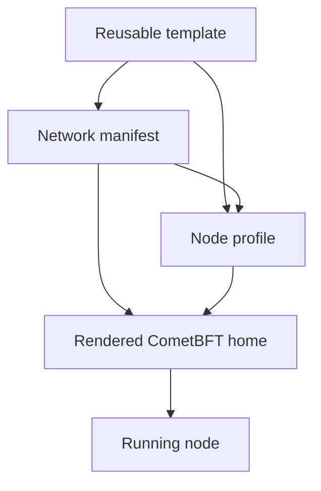

# Configuration

Xian node configuration has three layers:

1. a network manifest defines network-wide identity and defaults
2. a node profile records operator-local intent
3. `xian node init` renders the CometBFT home used at runtime



Use [Config Taxonomy](/node/config-taxonomy) for precedence and ownership
rules.

## Network Manifests

Canonical assets live in `xian-configs/networks/<name>/manifest.json`.
Manifests may define:

- chain identity and genesis source or bundle
- seeds and persistent peers
- snapshot bootstrap and trust material
- block-production policy
- pinned node images and release provenance
- runtime features and privacy artifact policy

The checked-in `local`, `devnet`, and `testnet` manifests are development or
rehearsal assets. The `xian-mainnet-1` manifest is a draft launch asset. None
of them implies that a public endpoint is live.

Templates under `xian-configs/templates/` are reusable starting points, not
networks.

Node initialization combines manifest seeds and persistent peers with the
profile's peer lists, in that order. A profile can add local peers without
discarding the network's persistent peers.

## Node Profiles

Profiles are JSON files normally created under `nodes/` by `xian-cli`. They
select local paths, keys, images, peers, pruning, block policy, logging,
simulation, metrics publishing, and optional services. The
fee policy is not a profile setting; it lives in the network manifest and
genesis.

See [Node Profiles](/node/profiles) for the profile contract. Prefer changing a
manifest or profile and re-rendering over hand-editing generated files.

## Rendered Home

The effective runtime home contains:

```text
config/config.toml
config/xian.toml
config/genesis.json
config/state-patches/
config/priv_validator_key.json
config/node_key.json
data/priv_validator_state.json
```

`config.toml` controls CometBFT. `xian.toml` controls Xian application
settings. Genesis, validator state, and keys must not be changed casually on an
existing network.

`xian_vm_v2` is the only supported execution runtime. Execution mode, VM
bytecode, and gas schedule are not operator-selectable configuration.

## Runtime Settings

Top-level Xian settings cover:

- pruning and retained block history
- application metrics and logging
- readonly simulation limits
- pending nonce reservation

The `[bds]` section configures the optional Postgres indexer, pool, catch-up,
and spool behavior. See [Runtime Features](/node/runtime-features).

The transaction fee mode and the per-transaction and per-block chi caps are
not `xian.toml` settings: they are the genesis fee policy `__fee_policy`,
identical on every validator, and a `xian.toml` that sets them is rejected at
startup. See [Chain Chi Caps](/concepts/chi#chain-chi-caps). Logging and query
limits can vary by node. The settings of the removed parallel executor
(`parallel_execution_*`) are rejected at startup as well; see
[Block Execution](/concepts/block-execution#no-parallel-execution).

## Stack Credentials

`xian-stack` creates a private, Git-ignored `.stack-secrets.env` for
`XIAN_BDS_PASSWORD` and `XIAN_POSTGRAPHILE_PASSWORD`.
`XIAN_STACK_SECRETS_ENV` selects a different path.

The file is literal data. Its current format stores values as JSON-quoted
strings; a shared reader decodes them for the supported stack workflows.
Nonempty environment values for either password take precedence over the stored
value.

Use the supported `xian` node commands, or run
`python3 ./scripts/backend.py ...` from the stack checkout. Do not source this
file or evaluate its contents in a shell: variable and command expressions in
credentials are literal characters.

## Reproducible Genesis Builds

The Python genesis helpers in `xian.genesis_builder` accept an optional
`genesis_time` argument. For a reproducible build, supply a timezone-aware ISO
timestamp such as `2026-01-01T00:00:00.000000Z` and pin the other inputs,
including contract sources, compiler/runtime versions, validator keys, and
constructor arguments.

Combined network builders normalize the timestamp to UTC and use the same
instant for the CometBFT genesis header, submission and deployed-contract
timestamps, and constructor `now`. Microsecond precision is preserved. A timestamp
without a timezone is rejected. When omitted, the timestamp is sampled once in
UTC for that build, so separate builds can produce different genesis state.

Networks that build genesis from a bundle on each node must pin
`genesis_time` in the network manifest. `xian network create` samples it once
into the manifest; `xian node init`, network join and operator bundles reject a
bundle genesis without it, because every node would otherwise sample its own
clock and build a different genesis.

Compare the complete generated genesis and application hashes before distributing
the accepted file to validators. This controls genesis construction only; do not
regenerate genesis for a running network as an operational update.

## Snapshot and State Sync

These are separate mechanisms:

- `snapshot_url` restores a prepared node-home or Xian application-state
  archive. Signed manifests can pin the archive hash, chain ID, and signer.
- CometBFT state sync uses trusted RPC servers, height, hash, and trust period
  to join through the consensus protocol.

Application state sync checks the downloaded archive's height and application
hash against the trusted offer before replacing durable state. State imports
reject duplicate state or nonce keys, validate protected metadata first, and replace application values and the durable
block marker in one database transaction. Exports read both from the same
committed database snapshot.

Snapshot restore replaces only the `data/` and `xian/` application roots.
Configuration and node identity are retained locally, including configured
validator signing state and key paths. Stop the node before restoring; see
[Snapshot Restore Boundaries](/node/recovery-plans#snapshot-restore-boundaries)
for archive validation and recovery requirements.

Use [Recovery Plans](/node/recovery-plans) for supported recovery paths.

## Public Exposure

The maintained stack binds RPC, query services, and metrics to loopback by
default. Public publishing requires both a command flag and its environment
gate:

| Surface | Flag | Environment gate |
| --- | --- | --- |
| CometBFT RPC | `--public-rpc` | `XIAN_PUBLIC_RPC_ENABLED=1` |
| dashboard/BDS/GraphQL | `--public-query` | `XIAN_PUBLIC_QUERY_ENABLED=1` |
| metrics | `--public-metrics` | `XIAN_PUBLIC_METRICS_ENABLED=1` |

The Xian application metrics port is published on `XIAN_APP_METRICS_HOST`
(default `127.0.0.1`) and `XIAN_APP_METRICS_PORT` (default `9108`); profiles set
them through `advanced.metrics.host` and `advanced.metrics.port`. The node
listens on `0.0.0.0:9108` inside the container regardless. A non-loopback
publish address requires the public-metrics gate.

`--public-query` does not publish the live RPC or mempool. Put any published
surface behind appropriate firewall, TLS, authentication, rate limits, and
monitoring.

## Common Local Endpoints

| Surface | Default |
| --- | --- |
| CometBFT P2P | `26656` |
| CometBFT RPC | `http://127.0.0.1:26657` |
| CometBFT metrics | `http://127.0.0.1:26660/metrics` |
| Xian metrics | `http://127.0.0.1:9108/metrics` |
| dashboard | `http://127.0.0.1:18080` (`single-node-dev`; backend default `8080`) |
| GraphQL | `http://127.0.0.1:5000/graphql` |
| GraphiQL browser UI | `http://127.0.0.1:5000/graphiql` |
| Prometheus | `http://127.0.0.1:9090` |
| Grafana | `http://127.0.0.1:3000` |

The local development template enables all services in this endpoint table.
Other profiles may not. Run `xian node endpoints <name>` for the effective
catalog. Bracket IPv6 literals in URLs, for example `http://[::1]:26657`.
