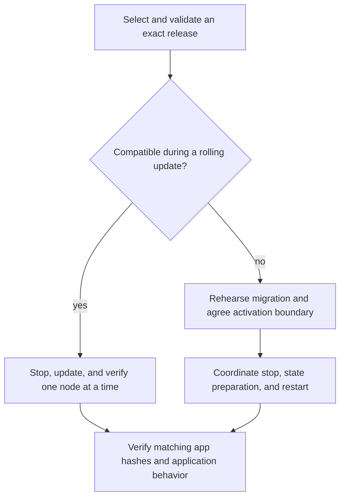

# Upgrading

Choose the upgrade procedure with the network's operators before changing a
validator. A compatible runtime update and a hardfork require different
coordination. This documentation describes the `xian_vm_v2` codebase; an
existing network running an earlier runtime is not automatically compatible.

## Current Local Execution Revision

Fresh local genesis commits `__execution_policy` with execution revision
`xvm-execution-13`, gas schedule `xvm-gas-6`, bytecode `xvm-2` and set codec
`xian-set-1`. The node requires this exact policy in genesis, persisted state
and its native runtime. Missing or mismatched policy fails before contract
bootstrap or state replacement. Contracts and governed state patches cannot
change this protected record. The comparison covers all four fields; matching
gas and codec versions do not make a different execution revision compatible.

V2 uses bounded integers and exact fixed-point decimals, with source-digit
literal handling and checked numeric ABI boundaries. Gas schedule 6 charges for
numeric work and for element work that grows with the size of a value: container
operations, text and byte scans and comparisons, values crossing a contract
boundary and whole-hash scans. One element-work unit costs 24 raw chi.
Dictionaries keep a hash index, so their lookups and updates cost the same at
any size. One V2 transaction may use at most 1,000,000 chi, and the chain's fee
policy sets a lower per-transaction cap. See
[Numbers, division and rounding](/smart-contracts/numbers), the
[chi cost table](/reference/chi-costs#element-work) and
[Chain Chi Caps](/concepts/chi#chain-chi-caps).

Revision 11 repriced the size-dependent operation families and introduced
the VM's per-transaction ceiling; revision 12 added the dictionary index. Each
changes chi for the same transactions, so each requires a new chain. Revision
13 keeps the gas schedule and bounds storage keys at 511 bytes, the largest key
LMDB stores: a write with a longer key now fails its transaction instead of
halting the chain when the block commits. It changes which transactions
succeed, so it also requires a new chain.

Since execution revision 10 a failed call's error category comes from structured
exception data produced by the VM (type and arguments), including exceptions
raised by a constructor during deployment and builtin exceptions raised by host
calls. Failure text is never parsed, so contract data inside a message cannot
select an exception type; a failure without structured data stays an opaque
message.
Only exported functions are allowed as external V2 entrypoints.
Constructors run through the trusted deployment path. Code-hash requests reject
unsupported `kind` selectors instead of treating them as source-hash requests.
These execution checks do not change the gas, bytecode or set-codec identifiers. Low-level native
V1 retains revision 7 for historical verification and migration; it is not a
current node execution policy.

This revision starts a fresh local chain; it does not migrate an earlier
database or activate a second VM at a block height. Preserve earlier state and
its immutable runtime image. Historical block corpora must be replayed with
their matching earlier image, as described in
[Localnet Replay](/node/localnet-e2e#replay-across-architectures).

Application snapshots use format 2 and carry the execution policy. Import and
peer state sync reject incompatible policy before replacing application state.
The exported state includes the protected policy in its application-root
commitment. An existing private network needs a separately agreed migration
plan before adopting this revision.

## Choose the Procedure

| Change | Procedure |
| --- | --- |
| Compatible image or operational update | Validate first, then restart nodes in the agreed maintenance order |
| Compiler, execution, metering, state format, or consensus-rule change | Coordinated network upgrade with an agreed activation boundary |
| Move an earlier network to `xian_vm_v2` | Rehearse contract and state migration before scheduling the cutover |

The `xian-deploy` upgrade playbook rolls hosts one at a time. After each host
it waits until CometBFT RPC reports `catching_up: false` and stops the rollout
when that does not happen within `xian_upgrade_health_timeout_seconds` (default
600, polled every `xian_upgrade_health_poll_seconds`). Set
`xian_upgrade_rpc_status_url` when RPC is not reachable on
`127.0.0.1:<rpc port>` from the host. Use that flow only when the old and
target versions can participate in the same network during the rollout. It
does not coordinate a hardfork activation height.

## Prepare the Release

Use one accepted release bundle for the fleet. Record:

- exact repository revisions and immutable node image digests
- compiler, VM, runtime-types, and CometBFT versions
- network manifest, genesis, and effective shared configuration
- the expected state at the transition and the restart procedure

The `xian_vm_v2` name alone is not a compatibility guarantee: two releases can
use that name while differing in compiler output, VM behavior, or metering.
The genesis fee policy (fee mode and the `max_tx_chi`/`max_block_chi` caps) is
chain state and therefore identical on every node of one chain.
Ed25519 signature acceptance is also consensus-sensitive: stricter rejection
rules in transaction admission or contract `crypto.verify` require coordinated
deployment, even though the signature algorithm and ordinary signing API stay
the same.

Validate the exact release before the maintenance window:

```bash
cd ~/xian/xian-stack
make validate
make smoke-cli
```

Use [5-Validator Localnet E2E](/node/localnet-e2e) and its release gate when
execution or network behavior changes. A test against current workspace
checkouts does not validate different revisions pinned in a release manifest.

## Compatible Runtime Update

1. Confirm that mixed versions are supported during the rollout.
2. Validate the target release and prepare backups before stopping a node.
3. Stop the node cleanly and capture its committed height and application hash.
4. Select the accepted image and matching profile/configuration.
5. Start the node and verify chain identity, catch-up, and runtime versions.
6. Continue with the next validator only after the current node is healthy.



The lifecycle commands are:

```bash
xian node stop validator-1
# Select the agreed release image and configuration before restarting.
xian node start validator-1
xian node status validator-1
xian node health validator-1
```

## Migrating an Earlier Network

`xian_vm_v2` executes persisted canonical IR in `__xian_ir_v1__`. Stored source
alone is not an executable contract on this runtime, and startup does not
compile an earlier network's source-only contracts automatically.

Offline migration analysis and rehearsal tooling lives in the optional
[xian-migration repository](https://github.com/xian-technology/xian-migration).
It consumes node/runtime tooling; migration implementation is not part of the
`xian-abci` node package or normal node startup. Follow that repo's instructions
for pinned dependencies and explicit network and contract-source inputs.
Its historical execution corpus checks recovered source through migrated native
artifacts, including state preservation without rerunning constructors, returns,
writes, events, failed-call rollback and subsequent calls. Successful compilation
alone does not establish execution equivalence. For actual applications, compare
representative calls against the old runtime and review every mismatch, source
override or exclusion together with affected callers.

Active legacy streams and their backing balances need an explicit migration
decision because the target currency contract lacks the legacy stream
operations. Contracts that read allowances through `currency.balances` also
need review: migrated allowances live in `currency.approvals`. Generated reports
or candidate state do not settle these compatibility decisions or authorize a
network cutover. Resolve them in the accepted migration plan and validate the
resulting application behavior before scheduling a transition.

Before scheduling a migration:

1. Inventory deployed contracts and their dependencies from a representative
   export of the existing network.
2. Compile every contract with the target compiler. Resolve unsupported syntax
   and check expected contract behavior on the target VM.
3. Prepare a deterministic state conversion that preserves the agreed balances,
   nonces, ownership, contract storage, validator state, and pending governance
   actions. Populate the target contract artifacts as part of that conversion.
4. Compare independent migration outputs and record the expected application
   hash. Re-run the conversion from the same input to verify repeatability.
5. Start a multi-validator rehearsal from the converted state. Exercise actual
   application flows, restart, snapshot restore, and indexed-history recovery.
6. Agree the stop boundary, which state is authoritative, and the conditions for
   restarting or aborting before executing the production procedure.

Do not redeploy all contracts through ordinary submission as a substitute for
state migration: submission runs constructors and initializes contract state.
The generic snapshot/import helpers restore their supported data formats;
they do not decide how an earlier runtime's contract state should be converted.

The draft mainnet manifest is a launch/rehearsal asset. It is not a migration
plan for an existing network. The network's accepted plan must explicitly
resolve chain identity, retained history, and the transition height.

## Backups and Recovery

Preserve a recoverable set of node configuration, validator signing state,
CometBFT data, and Xian application state at the agreed boundary. BDS history
requires its own database backup or a verified archival source for rebuilding.
An application-state snapshot alone is not a full node-home backup.

Rehearse restoring the artifacts on an isolated node before relying on them.
After the target runtime has committed blocks, switching the image back is not
by itself a rollback procedure. Use an agreed [Recovery Plan](/node/recovery-plans)
if coordinated restoration is required.

## Verify the Transition

Check more than container health:

- expected chain identity, height progression, and runtime versions
- matching `app_hash` values from multiple validators at the same height
- representative transfers, contract calls, events, and governance queries
- validator participation and peer connectivity
- BDS indexed height and recovery of optional services

Application state at height `H` is represented by the `app_hash` in block
`H + 1`. Compare hashes at matching heights rather than comparing each node's
latest response while the chain is advancing.
