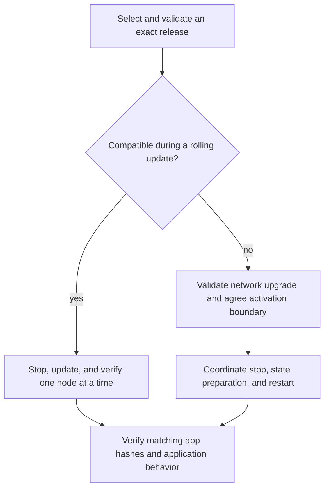

# Upgrading

Choose the upgrade procedure with the network's operators before changing a
validator. A compatible runtime update and a hardfork require different
coordination.

## Execution Policy

Genesis commits `__execution_policy` with execution revision
`xvm-execution-15`, gas schedule `xvm-gas-7`, bytecode `xvm-2` and set codec
`xian-set-1`, plus compiler admission revision `xian-admission-4` and transaction
admission revision `xian-fastpath-admission-3`. The node requires this exact
policy in genesis, persisted state and its native runtime. Missing or mismatched policy fails before contract
bootstrap or state replacement. Contracts and governed state patches cannot
change this protected record. Every field must match the selected runtime.
Startup checks the compiler revision in both the standalone compiler and the
compiler linked into the VM.

Use the native `xian-tech-vm-core` build required by the ABCI package in the
accepted release. At startup the node verifies the native interfaces it needs
for transaction admission and finalized receipts. A missing required
interface stops startup. Install the matching VM package and restart the
application if that check fails.

V2 uses bounded integers and exact fixed-point decimals, with source-digit
literal handling and checked numeric ABI boundaries. Gas schedule 7 charges for
numeric work and for element work that grows with the size of a value: container
operations, text and byte scans and comparisons, values crossing a contract
boundary and whole-hash scans. One element-work unit costs 24 raw chi.
Dictionaries keep a hash index, so their lookups and updates cost the same at
any size. One V2 transaction may use at most 1,000,000 chi, and the chain's fee
policy sets a lower per-transaction cap. See
[Numbers, division and rounding](/smart-contracts/numbers), the
[chi cost table](/reference/chi-costs#element-work) and
[Chain Chi Caps](/concepts/chi#chain-chi-caps).

The VM charges canonical module IR reads before parsing or traversing
imports, using the transaction's shared budget. The first load of each module
pays the same charge on cold and warm nodes. Preparation includes dynamic
imports and deployment constructors. See [Module preparation](/reference/chi-costs#accounting).

The current runtime uses structured VM exception types and arguments for failure
categories, never parsed message text. Only exported functions are external
entrypoints; constructors run through deployment. State roots commit exact
stored value bytes (`xian-state-root-v3`). These rules, numeric semantics and
metering all affect replay compatibility.

Application snapshots use format 2 and carry the execution policy. Import
checks the policy before replacing application state. Bootstrap a node through
replay or a verified full node-store snapshot. The exported state includes
the protected policy in its application-root commitment.

## Consensus Backend Compatibility

The supported source baseline is unmodified upstream **CometBFT v0.40.0**
with its matching Xian application. Use the exact source pinned by the accepted
stack release. Keep the source archive hash and immutable image digest with
that release's provenance. Expected CLI and deployment metadata describes the
intended build; it is not attestation of an arbitrary installed binary.

The schema-version-1 release manifest records `build.cometbft_version`,
`cometbft_source_url`, `cometbft_source_commit` and
`cometbft_source_sha256`. Built images carry the corresponding `version`,
`source_url`, `source_commit` and `source_sha256` in
`/usr/local/share/xian/cometbft-provenance.json`, with image labels
`org.xian.cometbft.version` and `org.xian.cometbft.source.commit`.

The pinned official `v0.40.0` source is commit
`0880b4d378f347ab16e54ec677ff50d803f37d62`, archive SHA-256
`c421c1461494d4e1e922a334f1899aab2f638e990a465316ed6e2437a8d71a66`.
The unmodified binary reports `0.39.0` together with the source commit.
Record the source release, commit, archive checksum and actual binary version
separately. A version string alone does not identify or authenticate a build.

The application uses a version-2 `__evidence_policy` growth schedule to track
evidence retention and security checkpoints.

A consensus-sensitive backend change requires a fresh chain or a separately
reviewed network upgrade. Do not swap a different backend into an existing
development or live chain merely because the processes speak ABCI. See
[Bootstrap and Snapshots](/node/configuration#bootstrap-and-snapshots)
for replay and full node-store restore requirements.

## Choose the Procedure

| Change | Procedure |
| --- | --- |
| Compatible image or operational update | Validate first, then restart nodes in the agreed maintenance order |
| Compiler, execution, metering, state format, or consensus-rule change | Coordinated network upgrade with an agreed activation boundary |

The `xian-deploy` upgrade playbook rolls hosts one at a time. After each host
it waits until CometBFT RPC reports `catching_up: false` and stops the rollout
when that does not happen within `xian_upgrade_health_timeout_seconds` (default
600, polled every `xian_upgrade_health_poll_seconds`). Set
`xian_upgrade_rpc_status_url` when RPC is not reachable on
`127.0.0.1:<rpc port>` from the host. Use that flow only when the deployed and
target versions can participate in the same network during the rollout. It
does not coordinate a hardfork activation height.

## Prepare the Release

Use one accepted release bundle for the fleet. Record:

- exact repository revisions and immutable node image digests
- compiler, VM, runtime-types, and CometBFT versions
- network manifest, genesis, and effective shared configuration
- the expected state at the transition and the restart procedure

The `xian_vm_v2` name alone is not a compatibility guarantee: two releases can
use that name while differing in compiler output, VM behavior, or metering.
The genesis fee policy (fee mode and the `max_tx_chi`/`max_block_chi` caps) is
chain state and therefore identical on every node of one chain.
Ed25519 signature acceptance is also consensus-sensitive: stricter rejection
rules in transaction admission or contract `crypto.verify` require coordinated
deployment, even though the signature algorithm and ordinary signing API stay
the same.

Validate the exact release before the maintenance window:

```bash
cd ~/xian/xian-stack
make validate
make smoke-cli
```

Use [5-Validator Localnet E2E](/node/localnet-e2e) and its release gate when
execution or network behavior changes. A test against current workspace
checkouts does not validate different revisions pinned in a release manifest.

## Compatible Runtime Update

1. Confirm that mixed versions are supported during the rollout.
2. Validate the target release and prepare backups before stopping a node.
3. Stop the node cleanly and capture its committed height and application hash.
4. Select the accepted image and matching profile/configuration.
5. Start the node and verify chain identity, catch-up, and runtime versions.
6. Continue with the next validator only after the current node is healthy.



The lifecycle commands are:

```bash
xian node stop validator-1
# Select the agreed release image and configuration before restarting.
xian node start validator-1
xian node status validator-1
xian node health validator-1
```

## Backups and Recovery

Preserve a recoverable set of node configuration, validator signing state,
CometBFT data, and Xian application state at the agreed boundary. BDS history
requires its own database backup or a verified archival source for rebuilding.
An application-state snapshot alone is not a full node-home backup.

Rehearse restoring the artifacts on an isolated node before relying on them.
After the target runtime has committed blocks, switching the image back is not
by itself a rollback procedure. Use an agreed [Recovery Plan](/node/recovery-plans)
if coordinated restoration is required.

## Verify the Transition

Check more than container health:

- expected chain identity, height progression, and runtime versions
- matching `app_hash` values from multiple validators at the same height
- representative transfers, contract calls, events, and governance queries
- validator participation and peer connectivity
- BDS indexed height and recovery of optional services

Application state at height `H` is represented by the `app_hash` in block
`H + 1`. Compare hashes at matching heights rather than comparing each node's
latest response while the chain is advancing.
