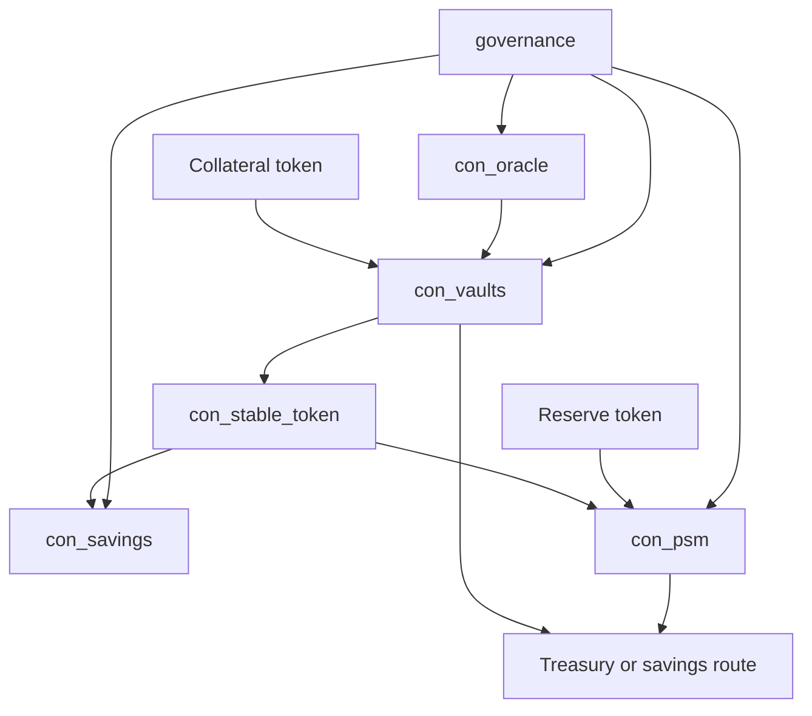

# Stable Protocol

`xian-stable-protocol` owns the overcollateralized stable-vault product: an
on-chain CDP-style stablecoin with a savings vault, a peg-stability module,
a governed oracle, and an executable bootstrap path that wires the system
together.

- Owning repo: `xian-stable-protocol`
- Contract bundle: `xian-stable-protocol/contract-bundle.json`
- Bootstrap script: `xian-stable-protocol/scripts/bootstrap_protocol.py`

## Lifecycle

- Install phase: post-genesis
- Included in genesis: no
- Shipped with node image: no
- Installer: `xian-stable-protocol/scripts/bootstrap_protocol.py`

## Protocol Shape



## On-Chain Contracts

| Contract | Role |
|----------|------|
| `con_stable_token` | controller-minted fungible stable asset |
| `con_oracle` | governed multi-reporter oracle with freshness and quorum controls |
| `con_savings` | share-based savings vault whose share price increases when fees are routed in |
| `con_vaults` | CDP engine: vault types, borrowing, debt-share accrual, partial liquidation, auctions, and bad-debt handling |
| `con_psm` | peg-stability module that mints and redeems against reserve assets with configurable fees |

Design highlights:

- overcollateralized vaults mint the stable asset; vault debt accrues a
  stability fee through per-type rate accumulators and debt shares
- liquidation supports partial cure, auction cancellation, and owner cure;
  auction settlement records bad debt honestly when collateral cannot cover
  system debt
- a surplus buffer and recapitalization path keep protocol losses explicit
- governance changes are explicit and delayed, executed through Xian's
  `validators` and `governance` contracts after handoff

Recapitalization requires an existing vault type and rejects an unknown ID
before transferring tokens. Existing inactive types remain recapitalizable.

## Installing The Protocol

Validate the hash-pinned bundle with the generic `xian-cli` helper, then run
the repo-owned bootstrap against a healthy node:

```bash
uv run --project ../xian-cli xian contract bundle validate contract-bundle.json
uv run --group deploy python scripts/bootstrap_protocol.py --skip-sample-tokens
```

The vaults require the canonical `time_checkpoints` protocol-1 service and a
matching node keeper. Bootstrap checks service readiness before
deployment; it does not install that platform service. An offline contract test
must supply the real service and explicit keeper/checkpoint transitions.

The bootstrap deploys any missing protocol contracts, enables `con_vaults`
and `con_psm` as stable-token controllers, configures oracle reporters and an
initial price feed, sets fee-routing addresses, seeds a default vault type
when none exists, and starts governance handoff by default. The operator
wallet must match the configured initial governor during bootstrap.

The bootstrap validates the complete bundle before connecting and retains the
verified sources for deployment. `--bundle` selects its source paths and
deployment order. Product configuration supplies constructor arguments and
target names. The five protocol contracts and any sample tokens must use
distinct names. Their names must also differ from the chain's governance and
membership contracts and from collateral or reserve tokens supplied with
`--skip-sample-tokens`. Each deployment and configuration write supplies its simulated
chi plus the SDK margin; `XIAN_STABLE_DEPLOY_CHI` and `XIAN_STABLE_TX_CHI` set
explicit budgets only for profiles without readonly simulation. Sample collateral
and reserve tokens reuse the validated stable-token source. The deploy dependency
group includes the shared CLI validator and Python SDK.

PSM minting requires the reserve balance to increase by the quoted `reserve_in`.
Vault creation and collateral deposits likewise require the exact requested
collateral to arrive before crediting the position. Fee-on-transfer and no-op
incoming assets revert atomically; quotes and collateral accounting remain
based on exact amounts.

### Financial Clock Views

New debt and fee changes use immutable successor anchors from
`time_checkpoints`. New principal is owed immediately, including while its
anchor is pending; the pending state delays fee accrual rather than cancelling
the debt. Read `get_vault` and `get_vault_type` for the resolved debt, rate and
effective `stability_fee_bps`. A pending fee change remains visible through
`pending_stability_fee_bps` and `pending_fee_height`; raw stored values can lag
the getter's resolved projection after the anchor is ready.

Auction opening, restart and near-end extensions also wait for successor
anchors. `get_auction` can return `None` for `auction_opened_at` or
`auction_end_time` while that work is pending. Preserve those nulls and disable
settlement until an end time is available. Once ready, the getter resolves the
recorded anchor without an extra activation transaction. Do not substitute local
time or the request block timestamp.

Use direct contract/RPC views for these clocks. BDS indexing height or zero lag
does not attest to keeper state; see [BDS Consistency](/api/bds#consistency) and
[Financial Timer Anchors](/concepts/time-and-blocks#financial-timer-anchors).

### Required Wiring

The protocol is not correctly wired unless fee destinations are configured:

```python
con_stable_token.set_controller(account='con_vaults', enabled=True)
con_stable_token.set_controller(account='con_psm',    enabled=True)

con_vaults.set_savings_contract(target_contract='con_savings')
con_vaults.set_treasury_address(address='treasury')
con_psm.set_treasury_address(address='treasury')
```

Without these, fees fall back to the configured governor — valid contract
behavior, but not the intended production setup.

### Governance Handoff

Bootstrap *starts* the transfer to the chain `governance` contract.
Acceptance happens through ordinary governance proposals that call
`accept_governance()` on each protocol contract. If handoff was skipped for
local testing (`--no-start-governance-handoff`), start it later by re-running
the bootstrap script.

## Deployment Readiness

This is a deployable reference implementation. Production use requires an
oracle design that establishes external price freshness, defines source and
clock trust, and bounds financial exposure. Validate authorization and
settlement behavior across arbitrary delays before using it with material value.

Consensus-time freshness checks alone do not establish external price freshness
across an idle gap. Successor anchors for debt and auctions do not provide that
oracle guarantee. Before using the protocol with material value, review oracle
governance, collateral parameters, liquidation/auction behavior, fee routing,
controller permissions, emergency actions, monitoring, and governance handoff.

## Related Pages

- [Products overview](/products/)
- [Protocol Governance & State Patches](/node/protocol-governance)
