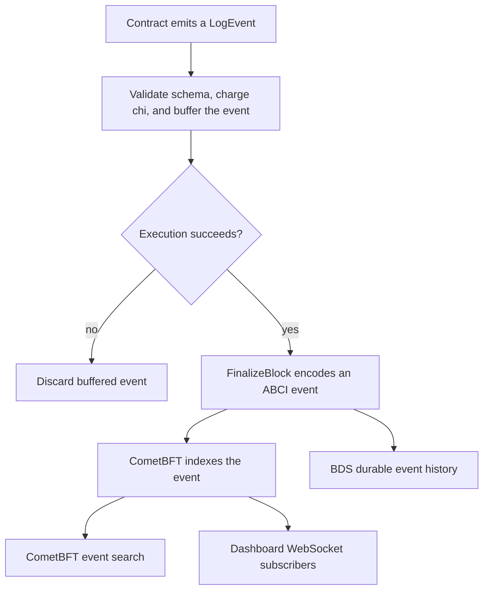

# Events

Events are structured signals emitted during contract execution. Use them for
activity feeds, notifications, and audit trails; use storage when the contract
must read a value later.

## Define and Emit

```python
TransferEvent = LogEvent(
    "Transfer",
    {
        "from": indexed(str),
        "to": indexed(str),
        "amount": (int, float, decimal),
    },
)

@export
def transfer(amount: float, to: str):
    assert amount > 0, "Amount must be positive"
    assert balances[ctx.caller] >= amount, "Insufficient balance"

    balances[ctx.caller] -= amount
    balances[to] += amount
    TransferEvent({"from": ctx.caller, "to": to, "amount": amount})
```

Indexed fields can be filtered by CometBFT event search. Keep indexing limited
to fields applications actually query.

`indexed` requires at least one positional argument. `indexed(int, str)` and
`indexed((int, str))` describe the same type choice: a single tuple argument is
unpacked, then a singleton type is collapsed. Thus `indexed((int,))` is equivalent
to `indexed(int)`. `indexed(())` produces metadata with an empty type tuple,
which is invalid as an event field type.

## Call Signatures

An event object accepts exactly one payload dictionary, either positionally or
with the keyword `data`. Its public `write_event` method uses `event_data`:

```python
Changed = LogEvent("Changed", {"value": indexed(int)})

@export
def announce(value: int):
    Changed(data={"value": value})
    emit = Changed.write_event
    emit(event_data={"value": value})
```

This example emits two events. Saving `Changed` itself as a local callable also
uses the `data` signature. Individual fields such as `Changed(value=3)`, an
extra positional argument, unknown keywords and duplicate payload arguments
are rejected.

The unbound method requires a declared event as its receiver:

```python
@export
def announce_unbound(value: int):
    event_type = importlib.Var("event", LogEvent).type
    emit = event_type.write_event
    emit(self=Changed, event_data={"value": value})
```

Bound and unbound forms use the declared event's schema, contract identity,
validation and chi charges. They cannot emit for an unrelated storage receiver
or create a new event declaration. Callable aliases remain execution-local;
they cannot be stored or returned as public transaction results.

## Rules

- declare `LogEvent` at module scope
- give every event a stable name and field schema
- pass one dictionary with exactly the declared field names and matching values
- use deterministic contract types
- failed transactions discard their events with their writes
- event emission consumes chi

Schemas must contain at least one field and can index at most three fields.
Supported field types are `str`, `int`, `float`, `bool`, `bytes`, `bytearray`,
`set`, `frozenset` and `decimal`, or a nonempty tuple of these types. Each
field's `str(value)` representation must fit within 1,024 UTF-8 bytes. For a
string field, multibyte characters therefore consume more than one byte.

The schema is captured when the event is declared. Later changes to the source
schema dictionary or an indexed-field specification do not change that event.
Emitted mutable payloads are also snapshots; modifying the original value after
emission does not alter the buffered event.

Every field must also be encodable by the node, including nested contents.
Unsupported values fail the transaction and discard all application writes and
events; they are not converted to strings. See the
[State Model](/concepts/state-model#stored-and-event-values) for the value boundary.

## How Events Flow Through the System



## Read Events

CometBFT search can filter indexed attributes:

```text
GET /tx_search?query="Transfer.to='bob'"
```

The dashboard WebSocket provides live, non-durable delivery:

```json
{"action":"subscribe","type":"event","contract":"currency","event":"Transfer"}
```

BDS provides durable indexed history and cursors:

```text
/events/currency/Transfer/limit=50/after_id=0
/events_for_tx/<tx_hash>
```

BDS is eventually consistent with finalized state. Use the event ID cursor for
resumable consumers.

## Events vs. State

| Events | State |
| --- | --- |
| describe that an action occurred | stores values used by later contract calls |
| live and indexed-history consumption | direct current-state queries |
| discarded on failed execution | writes rolled back on failed execution |

Events are not a substitute for balances, ownership, or authorization state.

## Related Pages

- [WebSocket Subscriptions](/api/websockets)
- [BDS Indexed Queries](/api/bds)
- [Inspecting Return Values and Events](/smart-contracts/testing/return-values)
