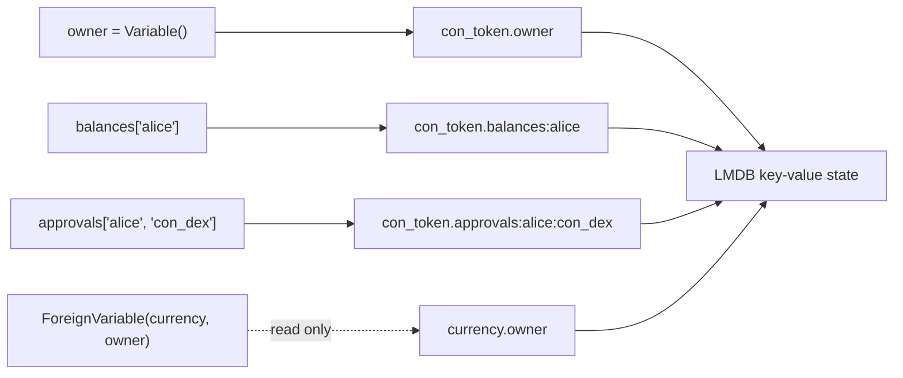

# Storage Overview

Xian contract state is exposed through four ORM-style primitives:

- `Variable`
- `Hash`
- `ForeignVariable`
- `ForeignHash`

All of them ultimately map to deterministic key-value storage in LMDB.



Every declaration resolves to flat keys of the form
`contract.variable` or `contract.variable:key1:key2:...`, which is also the
shape you use when reading state through `/get/<state-key>`.

## What to Use

| Primitive | Use |
|-----------|-----|
| `Variable` | one stored value |
| `Hash` | keyed or multi-dimensional data |
| `ForeignVariable` | read another contract's variable |
| `ForeignHash` | read another contract's hash |

## Key Facts

- `Variable` uses `.set()` and `.get()`, and also supports top-level dict/list
  helpers for mutable values
- `Hash` uses index syntax like `balances["alice"]`
- hash keys can be multi-dimensional
- foreign storage is read-only by design
- values are encoded deterministically for consensus safety

Use the pages in this section for the exact behavior of each primitive.

The node validates writes and events against its consensus encoding before
applying them. Unsupported nested values fail the whole transaction rather
than being stored as text. See the
[State Model](/concepts/state-model#stored-and-event-values) for supported value
boundaries and rollback behavior.

## Persistent sets

Deterministic `set()` and `frozenset()` values can be stored under the current
[execution revision](/node/upgrading#current-local-execution-revision).
Their `xian-set-1` encoding preserves member types, including tuples, nested
frozen sets, raw Decimal precision and trailing zeros, and float signed zero.
View-produced builtin sets must first be converted to a deterministic wrapper;
callables and interface descriptors cannot be stored through either kind.
Numeric members must be finite, including when chi metering is disabled.

The SDK decodes set query responses into their deterministic wrapper types.
Raw queries return tagged JSON with `info="dict"`, for example:

```json
{"__set__":{"codec":"xian-set-1","items":[["int","3"],["str","alice"]]}}
```

Each set envelope is bounded to depth 64, 131,072 typed member nodes, and
8 MiB of ASCII-escaped JSON. Across a whole stored payload, the sum of the
squares of all set cardinalities must not exceed 8,388,608. This bounds the
work required to normalize sets; a single flat set can contain at most 2,896
members. Nested sets also consume this work budget. Normal metered storage
write limits remain stricter. Native byte charges use canonical compact UTF-8
JSON; the encoding size cap conservatively accounts for ASCII escaping.

Ordinary stored dictionaries cannot contain reserved runtime tag keys such as
`__set__`, `__frozenset__`, `__fixed__` or `__big_int__`. Supply the actual typed
value instead of constructing a codec tag by hand.

## Declarations and storage authority

Declare writable `Variable` and `Hash` storage, and `LogEvent` schemas, directly
at module scope. The compiler binds each declaration to the contract and its
variable name:

```python
balance = Variable(default_value=0)

@export
def update(value: int):
    balance.set(value)
```

Constructing writable storage inside a function is not supported. Constructor
aliases and class information obtained from `importlib.Var(...).type` cannot
be used to construct storage or choose another contract's writable keys.
Use the declared object to update your own state, and call the other
contract's exported functions to request changes to its state.

The direct `ForeignVariable(...)` and `ForeignHash(...)` forms below are the
read-only exception for function-local references. Use those constructor
names directly; aliases and descriptor type values do not create references.

## Dynamic foreign reads

Create a foreign reference inside a function when its target is known only at
call time. The native VM supports hash indexing, hash `.all(*prefix)` scans,
and variable `.get()` reads:

```python
@export
def standard_of(contract: str):
    metadata = ForeignHash(foreign_contract=contract, foreign_name="metadata")
    return metadata["standard"]
```

Use `foreign_contract` and `foreign_name` keyword arguments. Each target must be
one ASCII identifier (letters, digits, underscores; no leading digit), not a
composed state key. Missing values return `None`. References are local values;
they cannot be stored on-chain or passed through external contract calls.
Aliases retain their target, and each read observes current transaction state.

Foreign references remain read-only: assignment, clearing, cloning into them,
and mutating helpers are rejected. A fetched list or dictionary is a copy;
changing a local copy does not change the foreign state. Reads and scans incur
the VM's normal storage operation and byte charges and obey the transaction's
chi budget.
